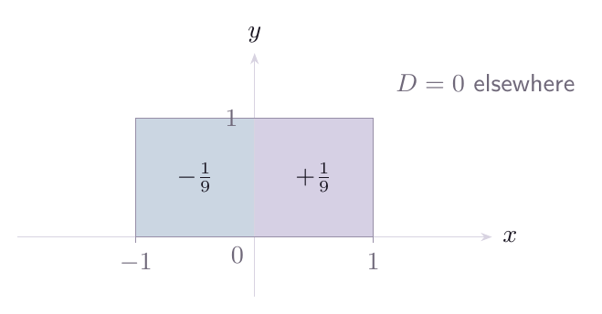

# Hoeffding's covariance identity

*Independence is a pointwise equality of distribution functions; uncorrelatedness is the same equality, integrated*

**Probability Notes No. 00** · Omid Shams Solari, Ph.D. · 8 November 2026

[PDF (A4)](pdf/pn-00-hoeffding.pdf) · [PDF (screen)](pdf/pn-00-hoeffding-screen.pdf) · [Notebook](notebook.ipynb) · [LaTeX source](main.tex)

> **TL;DR.** Two random variables are independent exactly when their joint distribution function factorises into the product of its marginals. Hoeffding (1940) showed that their covariance is the integral of the difference between the two. Independence requires that difference to vanish everywhere; zero covariance requires only that its integral vanish.

## Setup and notation

Let $(X,Y)$ be a random vector on a probability space $(\Omega,\mathcal{F},\mathbb{P})$, taking values in $\mathbb{R}^2$.

| Symbol                                     | Meaning                                       |
|:-------------------------------------------|:----------------------------------------------|
| $F_{X,Y}(x,y)=\mathbb{P}(X\le x,\,Y\le y)$ | joint distribution function                   |
| $F_X(x)$, $F_Y(y)$                         | marginal distribution functions               |
| $\bar F_X=1-F_X$, $\bar F_Y=1-F_Y$         | survival functions                            |
| $D(x,y)=F_{X,Y}(x,y)-F_X(x)F_Y(y)$         | dependence function                           |
| $(X_1,Y_1),(X_2,Y_2)$                      | independent copies of $(X,Y)$ (see the proof) |
| $C$                                        | copula of $(X,Y)$ (continuous marginals)      |

By definition, $X\mathrel{\perp\!\!\!\perp}Y$ if and only if $D(x,y)=0$ for every $(x,y)\in\mathbb{R}^2$.

**Assumption A1.** $\mathbb{E}|X|<\infty$, $\mathbb{E}|Y|<\infty$ and $\mathbb{E}|XY|<\infty$.

Assumption A1 follows from $\mathbb{E}X^2,\mathbb{E}Y^2<\infty$ (Cauchy–Schwarz), the form usually quoted; the proof requires only Assumption A1. *Uncorrelated* means $\operatorname{Cov}(X,Y)=0$.

## Result

> **Theorem 1 (Hoeffding, 1940).** Under Assumption A1, $D$ is Lebesgue integrable on $\mathbb{R}^2$ and
>
> $$
> \operatorname{Cov}(X,Y)=\iint_{\mathbb{R}^2}\big[F_{X,Y}(x,y)-F_X(x)F_Y(y)\big]\mathrm{d}x\mathrm{d}y . \tag{1}
> $$

**Remark 2.** Equivalently,

$$
\operatorname{Cov}(X,Y)=\iint_{\mathbb{R}^2}\big[\mathbb{P}(X>x,Y>y)-\bar F_X(x)\bar F_Y(y)\big]\mathrm{d}x\mathrm{d}y,
$$

since by inclusion–exclusion $\mathbb{P}(X>x,Y>y)-\bar F_X(x)\bar F_Y(y)=D(x,y)$ pointwise.

## Proof

**Lemma 3.** For $a,b\in\mathbb{R}$,

$$
\begin{aligned}
a-b&=\int_{\mathbb{R}}\big[\mathbf{1}\{b\le u\}-\mathbf{1}\{a\le u\}\big]\mathrm{d}u,\\
|a-b|&=\int_{\mathbb{R}}\big|\mathbf{1}\{b\le u\}-\mathbf{1}\{a\le u\}\big|\mathrm{d}u.
\end{aligned} \tag{2}
$$

*Proof.* If $a=b$ the integrand vanishes. If $a>b$ it equals $1$ on $[b,a)$ and $0$ elsewhere; if $a<b$ it equals $-1$ on $[a,b)$ and $0$ elsewhere. Both identities follow. ∎

*Proof of Theorem 1.* **Step: Symmetrisation.** Let $(X_1,Y_1)$ and $(X_2,Y_2)$ be independent copies of $(X,Y)$: two independent draws from the joint law of $(X,Y)$, realised on $\Omega\times\Omega$ if necessary. The argument follows Lehmann (1966) \[9\]. Expanding,

$$
\begin{aligned}
\mathbb{E}\big[(X_1-X_2)(Y_1-Y_2)\big]&=\mathbb{E}[X_1Y_1]+\mathbb{E}[X_2Y_2]-\mathbb{E}[X_1Y_2]-\mathbb{E}[X_2Y_1]\\
&=2\mathbb{E}[XY]-2\mathbb{E}X\,\mathbb{E}Y.
\end{aligned}
$$

Each same-copy term equals $\mathbb{E}[XY]$, since $(X_i,Y_i)$ has the law of $(X,Y)$. Each cross term has its factors in different copies: on $\Omega\times\Omega$, with points $(\omega_1,\omega_2)$, $X_1$ depends only on $\omega_1$ and $Y_2$ only on $\omega_2$, so $\mathbb{E}|X_1Y_2|=\mathbb{E}|X|\,\mathbb{E}|Y|$ by Tonelli and $\mathbb{E}[X_1Y_2]=\mathbb{E}X\,\mathbb{E}Y$ by Fubini; likewise for $X_2Y_1$. Assumption A1 makes all four terms finite, which justifies the expansion. Hence $\operatorname{Cov}(X,Y)=\tfrac12\,\mathbb{E}[(X_1-X_2)(Y_1-Y_2)]$. The means have dropped out: $X-\mathbb{E}X$ and $Y-\mathbb{E}Y$ are replaced by the differences $X_1-X_2$ and $Y_1-Y_2$, to which Lemma 3 applies directly.

**Step: Integral representation.** Apply Lemma 3 in $u$ to $X_1-X_2$ and in $v$ to $Y_1-Y_2$, and multiply:

$$
(X_1-X_2)(Y_1-Y_2)=\iint_{\mathbb{R}^2}\Phi(u,v)\mathrm{d}u\mathrm{d}v, \tag{3}
$$

where

$$
\Phi(u,v)\mathrel{:=}\big[\mathbf{1}\{X_2\le u\}-\mathbf{1}\{X_1\le u\}\big]\big[\mathbf{1}\{Y_2\le v\}-\mathbf{1}\{Y_1\le v\}\big].
$$

*Justification (Fubini–Tonelli).* By the second identity in (2), $\iint|\Phi|\mathrm{d}u\mathrm{d}v=|X_1-X_2|\,|Y_1-Y_2|$, and

$$
\begin{aligned}
\mathbb{E}\big[|X_1-X_2|\,|Y_1-Y_2|\big]&\le\mathbb{E}\big[(|X_1|+|X_2|)(|Y_1|+|Y_2|)\big]\\
&=2\mathbb{E}|XY|+2\mathbb{E}|X|\,\mathbb{E}|Y|<\infty .
\end{aligned}
$$

Here $\Phi$ depends on $(u,v)$ and on the outcome $\omega$, and is jointly measurable, being built from indicators of sets such as $\{(u,\omega):X_2(\omega)\le u\}$. By Tonelli the two displays give $\mathbb{E}\iint|\Phi|\mathrm{d}u\mathrm{d}v<\infty$, so $\Phi$ is integrable for the product of Lebesgue measure on $\mathbb{R}^2$ and $\mathbb{P}$, and Fubini gives

$$
\mathbb{E}\iint_{\mathbb{R}^2}\Phi\mathrm{d}u\mathrm{d}v=\iint_{\mathbb{R}^2}\mathbb{E}\,\Phi(u,v)\mathrm{d}u\mathrm{d}v .
$$

**Step: Expectation of the integrand.** Expanding $\Phi$ into four products of indicators,

$$
\begin{aligned}
\mathbb{E}\,\Phi(u,v)
&=\mathbb{P}(X_2\le u,Y_2\le v)-\mathbb{P}(X_2\le u,Y_1\le v)\\
&\quad-\mathbb{P}(X_1\le u,Y_2\le v)+\mathbb{P}(X_1\le u,Y_1\le v)\\
&=2F_{X,Y}(u,v)-2F_X(u)F_Y(v)=2D(u,v).
\end{aligned}
$$

Terms with both coordinates from the same copy give $F_{X,Y}$; terms mixing the copies factorise.

**Step: Conclusion.** Combining the three steps, $\operatorname{Cov}(X,Y)=\tfrac12\iint\mathbb{E}\,\Phi\mathrm{d}u\mathrm{d}v=\iint D\mathrm{d}u\mathrm{d}v$. Integrability of $D$ follows from $|D|=\tfrac12|\mathbb{E}\Phi|\le\tfrac12\mathbb{E}|\Phi|$ and the bound in the justification step. ∎

**Alternative route (sketch).** Write $X=\int_0^\infty\mathbf{1}\{X>t\}\mathrm{d}t-\int_{-\infty}^0\mathbf{1}\{X\le t\}\mathrm{d}t$, do the same for $Y$, multiply, take expectations quadrant by quadrant, and subtract $\mathbb{E}X\,\mathbb{E}Y$ written the same way. In every quadrant the integrand is $\pm[\text{joint}-\text{product}]$, and identities such as $\mathbb{P}(X\le u,Y>v)-F_X(u)\bar F_Y(v)=-D(u,v)$ make the four signs agree. The symmetrisation proof avoids this bookkeeping.

## Insights

1.  **Independence and zero covariance compared.** Independence says $D\equiv0$, a condition on a whole function on $\mathbb{R}^2$. Zero covariance says $\iint D=0$, a single linear functional of the same function. The first implies the second at once. The converse fails exactly when $D$ takes both signs and its positive and negative parts cancel, as in the worked example below.

2.  **The role of Lebesgue measure.** Covariance integrates $D$ against $\mathrm{d}x\mathrm{d}y$, which depends on the scale of each axis. For continuous marginals, $D$ written in the coordinates $(F_X(x),F_Y(y))$ does not. This is why covariance changes under strictly increasing transformations of the variables while rank correlation does not. Invariance under such rescalings was the subject of Hoeffding’s dissertation.

3.  **Sign information.** When $D$ has constant sign, $|\operatorname{Cov}(X,Y)|=\iint|D|$ is the $L^1$ norm of $D$, so zero covariance forces $D\equiv0$ (Corollary 4).

> *Independence requires $D$ to vanish everywhere; zero covariance requires only that its integral vanish.*

## Uses and consequences

The results below follow from Theorem 1 by choosing a particular pair, integrand or integrating measure.

### Variance and mean absolute difference

Take $Y=X$ with $\mathbb{E}X^2<\infty$. Then $F_{X,X}(x,y)=F_X(x\wedge y)$ and, for $x\le y$, $D(x,y)=F_X(x)\bar F_X(y)$. By symmetry in $(x,y)$,

$$
\operatorname{Var}(X)=2\iint_{x<y}F_X(x)\,\bar F_X(y)\mathrm{d}x\mathrm{d}y , \tag{4}
$$

while taking expectations in the second identity of Lemma 3 gives the mean absolute difference (Gini, 1912 \[5\]),

$$
\mathbb{E}|X_1-X_2|=2\int_{\mathbb{R}}F_X(x)\,\bar F_X(x)\mathrm{d}x .
$$

Both are built from the kernel $F_X(x)\bar F_X(y)$, variance by integrating it over the plane and the mean absolute difference by integrating it along the diagonal.

### Positive quadrant dependence

$(X,Y)$ is *positively quadrant dependent* (PQD) if $D\ge0$ on $\mathbb{R}^2$ (Lehmann, 1966 \[9\]).

**Corollary 4 (Lehmann (1966) \[9\]).** Under Assumption A1: (i) if $(X,Y)$ is PQD then $\operatorname{Cov}(X,Y)\ge0$; (ii) if $(X,Y)$ is PQD and $\operatorname{Cov}(X,Y)=0$, then $X\mathrel{\perp\!\!\!\perp}Y$.

*Proof.* (i) is immediate from (1). For (ii), $D\ge0$ and $\iint D=0$ give $D=0$ Lebesgue-almost everywhere. Fix $(x,y)$. A null set contains no open square, so each square $(x,x+\tfrac1n)\times(y,y+\tfrac1n)$ contains a point $(x_n,y_n)$ with $D(x_n,y_n)=0$. Monotonicity gives $F_{X,Y}(x,y)\le F_{X,Y}(x_n,y_n)\le F_{X,Y}(x+\tfrac1n,y+\tfrac1n)$, and the right side tends to $F_{X,Y}(x,y)$ by continuity of $\mathbb{P}$ along decreasing events; likewise for $F_X,F_Y$. Hence $D(x,y)=\lim_n D(x_n,y_n)=0$. ∎

So zero covariance does imply independence when the dependence has a fixed sign. The bivariate normal with $\rho\ge0$ is PQD, by a Gaussian comparison inequality (Slepian, 1962 \[12\]) (not proved here).

### An association inequality

**Corollary 5 (association; see Esary et al. (1967) \[3\]).** If $f,g$ are non-decreasing and $f(X),g(X)$ have finite second moments, then $\operatorname{Cov}(f(X),g(X))\ge0$.

*Proof.* Let $U=f(X)$ and $V=g(X)$. Each of the events $\{U\le u\}$ and $\{V\le v\}$ has the form $\{X\in I\}$ with $I$ a down-set of $\mathbb{R}$, so one contains the other and

$$
\mathbb{P}(U\le u,V\le v)=\min\{\mathbb{P}(U\le u),\mathbb{P}(V\le v)\}\ge\mathbb{P}(U\le u)\mathbb{P}(V\le v).
$$

Thus $(U,V)$ is PQD; apply Corollary 4(i). ∎

### Copulas and rank correlation

Let $F_X,F_Y$ be continuous. Then $(U,V)=(F_X(X),F_Y(Y))$ has uniform marginals, and its distribution function $C$, the copula, satisfies $F_{X,Y}(x,y)=C(F_X(x),F_Y(y))$ (not proved here; see Sklar, 1959 \[11\]; Nelsen, 2006 \[10\]). Applying Theorem 1 to $(U,V)$, with $\operatorname{Var}U=\operatorname{Var}V=\tfrac1{12}$, gives the population form of the rank correlation of Spearman (1904) \[13\],

$$
\rho_S(X,Y)\mathrel{:=}\operatorname{Corr}(U,V)=12\iint_{[0,1]^2}\big[C(s,t)-st\big]\mathrm{d}s\mathrm{d}t , \tag{5}
$$

whereas for the original variables

$$
\operatorname{Cov}(X,Y)=\iint_{\mathbb{R}^2}\big[C(F_X(x),F_Y(y))-F_X(x)F_Y(y)\big]\mathrm{d}x\mathrm{d}y .
$$

Rank correlation therefore depends on $C$ alone, while covariance also depends on the marginals through the measure of integration.

### Extremal covariance for fixed marginals

Fix marginals with $\mathbb{E}X^2,\mathbb{E}Y^2<\infty$, so that Assumption A1 holds for every coupling (with only first moments the comonotone covariance can be $+\infty$). Every joint distribution function with these marginals satisfies the copula bounds (Hoeffding, 1940 \[6\]; Fréchet, 1951 \[4\])

$$
\max\{F_X(x)+F_Y(y)-1,0\}\le F_{X,Y}(x,y)\le\min\{F_X(x),F_Y(y)\},
$$

which follow from $\mathbb{P}(A\cap B)\ge\mathbb{P}(A)+\mathbb{P}(B)-1$ and $\mathbb{P}(A\cap B)\le\min\{\mathbb{P}(A),\mathbb{P}(B)\}$. The upper bound is attained by the comonotone coupling $(F_X^{-1}(W),F_Y^{-1}(W))$ and the lower by the countermonotone coupling $(F_X^{-1}(W),F_Y^{-1}(1-W))$, $W\sim\mathrm{Unif}(0,1)$ (attainment not proved here; see Nelsen, 2006 \[10\]). Inserting the bounds in (1), these two couplings maximise and minimise the covariance among all couplings with the given marginals. Correlation $\pm1$ needs an exact affine relation (the equality case of Cauchy–Schwarz), which the marginals may forbid: if $X,Y$ are lognormal, $Y=a-bX$ with $b>0$ is negative for large $X$, so correlation $-1$ is unattainable (Embrechts et al., 2002 \[2\]).

### Functions of the variables

Let $f,g$ be monotone and absolutely continuous, and let Assumption A1 hold for $(f(X),g(Y))$. Replacing (2) by $f(a)-f(b)=\int_{\mathbb{R}}[\mathbf{1}\{b\le u\}-\mathbf{1}\{a\le u\}]f'(u)\mathrm{d}u$, and noting that monotonicity gives $|f(a)-f(b)|=\int_{\mathbb{R}}|\mathbf{1}\{b\le u\}-\mathbf{1}\{a\le u\}|\,|f'(u)|\mathrm{d}u$, the proof of Theorem 1 goes through verbatim (Cuadras, 2002 \[1\]):

$$
\operatorname{Cov}\big(f(X),g(Y)\big)=\iint_{\mathbb{R}^2}D(x,y)\,f'(x)\,g'(y)\mathrm{d}x\mathrm{d}y .
$$

## Worked example

Let $X$ be uniform on $\{-1,0,1\}$ and $Y=X^2$. Since $\mathbb{E}X=\mathbb{E}X^3=0$, $\operatorname{Cov}(X,Y)=\mathbb{E}X^3-\mathbb{E}X\,\mathbb{E}X^2=0$, yet $Y$ is a function of $X$.

**Marginals.** $F_X$ equals $0,\tfrac13,\tfrac23,1$ on $(-\infty,-1)$, $[-1,0)$, $[0,1)$, $[1,\infty)$, and $F_Y$ equals $0,\tfrac13,1$ on $(-\infty,0)$, $[0,1)$, $[1,\infty)$.

**Dependence function.** For $y<0$, $F_{X,Y}=F_Y=0$, so $D=0$. For $y\ge1$, $F_{X,Y}=F_X$ and $F_Y=1$, so $D=0$. For $0\le y<1$, $\{Y\le y\}=\{X=0\}$, so $F_{X,Y}(x,y)=\tfrac13\mathbf{1}\{x\ge 0\}$ and $D(x,y)=\tfrac13[\mathbf{1}\{x\ge 0\}-F_X(x)]$:

| $x$                  | $(-\infty,-1)$ |  $[-1,0)$   |   $[0,1)$   | $[1,\infty)$ |
|:---------------------|:--------------:|:-----------:|:-----------:|:------------:|
| $D(x,y)$, $0\le y<1$ |      $0$       | $-\tfrac19$ | $+\tfrac19$ |     $0$      |



*Figure 1.* Dependence function $D$ for $X\sim\mathrm{Unif}\{-1,0,1\}$, $Y=X^2$. The two squares cancel, so $\operatorname{Cov}(X,Y)=0$ although $Y$ is a function of $X$.

The function $D$ is supported on two unit squares of opposite sign (Figure 1), so $\iint D=-\tfrac19+\tfrac19=0$, as (1) requires. For $x$ just below $0$, the events $\{X\le x\}$ and $\{Y=0\}$ are disjoint, a negative dependence; just above $0$ the dependence is positive. Covariance does not register this, but a functional of $|D|$ does, for instance $\sup|D|=\tfrac19$. Hoeffding’s test of independence (Hoeffding, 1948 \[7\]) is built on $\iint D^2\mathrm{d}F_{X,Y}$, which characterises independence for continuous joint distributions.

## Numerical check

Rows 1 to 3 integrate $D$ by trapezoidal quadrature on a grid; row 4 integrates the step function $D$ exactly in rational arithmetic.

| Case                                                                     |       Exact        |  Numerical  |
|:-------------------------------------------------------------------------|:------------------:|:-----------:|
| Normal, unit variances, $\rho=\tfrac12$: $\iint D\mathrm{d}x\mathrm{d}y$ |       $0.5$        | $0.500000$  |
| Same $D$: $12\iint D\mathrm{d}F_X\mathrm{d}F_Y$, i.e. (5)                | $0.4826^{\dagger}$ |  $0.4826$   |
| $X=Y\sim\mathrm{Exp}(1)$: $\iint D$, i.e. (4)                            |        $1$         | $0.999992$  |
| Worked example: $\iint D$                                                |        $0$         | $0$ (exact) |

<sup>$\dagger$</sup>From the closed form $\tfrac6\pi\arcsin(\rho/2)$ (not proved here; see Kruskal, 1958 \[8\]). Rows 1 and 2 integrate the same $D$, against $\mathrm{d}x\mathrm{d}y$ and against $\mathrm{d}F_X\mathrm{d}F_Y$ respectively (substitute $s=F_X(x)$, $t=F_Y(y)$ in (5)); only the measure differs.

**Code.** Every number in the table is printed by `code/check.py`, listed in full in the appendix (the code at the end); run it with `python3 code/check.py`. Its docstring gives the requirements.

## Notes

Wassily Hoeffding proved (1) in his Berlin doctoral dissertation, *Maßstabinvariante Korrelationstheorie* (‘Scale-invariant correlation theory’), published in 1940 (Hoeffding, 1940 \[6\]). The dissertation develops a theory of dependence invariant under monotone rescaling of the axes, the rank-based view of the copula section above, and already contains the copula bounds. In 1948 he based a test of independence on the whole of $D$ (Hoeffding, 1948 \[7\]). The identity reached a wide audience through Lehmann (1966) \[9\].

## References

1. Carles M. Cuadras. On the covariance between functions. *Journal of Multivariate Analysis* 81(1):19–27, 2002.
2. Paul Embrechts, Alexander J. McNeil, Daniel Straumann. Correlation and dependence in risk management: properties and pitfalls. *Risk Management: Value at Risk and Beyond*, 176–223, 2002.
3. J. D. Esary, F. Proschan, D. W. Walkup. Association of random variables, with applications. *Annals of Mathematical Statistics* 38(5):1466–1474, 1967.
4. Maurice Fréchet. Sur les tableaux de corrélation dont les marges sont données. *Annales de l'Université de Lyon, Section A, Série 3* 14:53–77, 1951.
5. Corrado Gini. *Variabilit\`a e Mutabilit\`a: Contributo allo Studio delle Distribuzioni e delle Relazioni Statistiche*. Tipografia di Paolo Cuppini, 1912.
6. Wassily Hoeffding. Maßstabinvariante Korrelationstheorie. *Schriften des Mathematischen Instituts und des Instituts für Angewandte Mathematik der Universität Berlin* 5(3):181–233, 1940. English translation in N. I. Fisher and P. K. Sen (eds.), \emphThe Collected Works of Wassily Hoeffding, Springer, 1994.
7. Wassily Hoeffding. A non-parametric test of independence. *Annals of Mathematical Statistics* 19(4):546–557, 1948.
8. William H. Kruskal. Ordinal measures of association. *Journal of the American Statistical Association* 53(284):814–861, 1958.
9. E. L. Lehmann. Some concepts of dependence. *Annals of Mathematical Statistics* 37(5):1137–1153, 1966.
10. Roger B. Nelsen. *An Introduction to Copulas*. Springer, 2006.
11. Abe Sklar. Fonctions de répartition \`a $n$ dimensions et leurs marges. *Publications de l'Institut de Statistique de l'Université de Paris* 8:229–231, 1959.
12. David Slepian. The one-sided barrier problem for Gaussian noise. *Bell System Technical Journal* 41(2):463–501, 1962.
13. C. Spearman. The proof and measurement of association between two things. *American Journal of Psychology* 15(1):72–101, 1904.

## Code

Numerical check (`code/check.py`); run `python3 code/check.py`, or open [the notebook](notebook.ipynb).

```python
"""Probability Notes No. 00: numerical check.

Prints every number in the PDF's check table.
Requires Python >= 3.8, NumPy >= 1.20 and
SciPy >= 1.6 (for scipy.integrate.trapezoid).
Tested with Python 3.13, NumPy 2.5, SciPy 1.18.
Run: python3 check.py
"""
from fractions import Fraction as Q
import numpy as np
from scipy.integrate import trapezoid
from scipy.stats import norm, multivariate_normal

def trapz2(d, x, y):
    return trapezoid(trapezoid(d, x, axis=1), y)

# 1. Bivariate normal, rho = 0.5: integral of D = rho.
rho = 0.5
g = np.linspace(-7.0, 7.0, 281)
x, y = np.meshgrid(g, g)
pts = np.column_stack([x.ravel(), y.ravel()])
cov = [[1, rho], [rho, 1]]
mvn = multivariate_normal([0, 0], cov)
d = mvn.cdf(pts).reshape(x.shape)
d -= norm.cdf(x) * norm.cdf(y)
print(f"Gaussian cov:  {trapz2(d, g, g):.6f}")

# 2. Same D, measure dF_X dF_Y: rank correlation.
w = norm.pdf(x) * norm.pdf(y)
rs = 12 * trapz2(d * w, g, g)
print(f"Rank corr:     {rs:.4f}")
print(f"Closed form:   {6/np.pi*np.arcsin(rho/2):.4f}")

# 3. X = Y ~ Exp(1): integral of D = Var(X) = 1.
t = np.linspace(0.0, 40.0, 4001)
fx, fy = np.meshgrid(1 - np.exp(-t), 1 - np.exp(-t))
d = np.minimum(fx, fy) - fx * fy
print(f"Exp(1) var:    {trapz2(d, t, t):.6f}")

# 4. X ~ Unif{-1,0,1}, Y = X^2: D is a step
# function; integrate it exactly on unit cells.
px = {-1: Q(1, 3), 0: Q(1, 3), 1: Q(1, 3)}
def D(u, v):
    fxy = sum(p for k, p in px.items()
              if k <= u and k * k <= v)
    fx = sum(p for k, p in px.items() if k <= u)
    fy = sum(p for k, p in px.items() if k * k <= v)
    return fxy - fx * fy
cells = [(u + Q(1, 2), v + Q(1, 2))
         for u in range(-2, 2) for v in range(-1, 2)]
tot = sum(D(u, v) for u, v in cells)
mx = max(abs(D(u, v)) for u, v in cells)
print(f"Example: int D = {tot}, sup|D| = {mx}")
```
