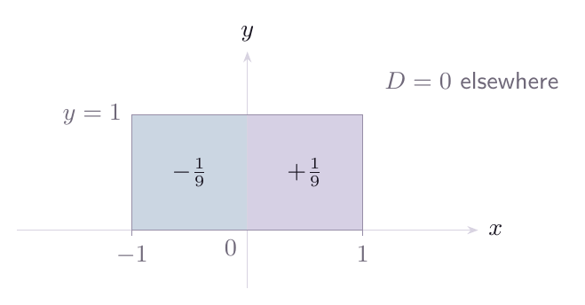

# The Quiet Theorems No. 00: Hoeffding’s covariance identity

*Independence is a pointwise equality of distribution functions; uncorrelatedness is the same equality, integrated*

Published 9 November 2026, revised 18 November 2026: https://omidsolari.substack.com/p/probability-notes-no-00-hoeffdings

> **TL;DR.** Two random variables are independent exactly when their joint distribution function factorises into the product of its marginals. Hoeffding (1940) showed that their covariance is the integral of the difference between the two. Independence requires that difference to vanish everywhere; zero covariance requires only that its integral vanish.

[PDF attachment: *The Quiet Theorems No. 00: Hoeffding’s covariance identity (PDF)*. Full proofs, references and the numerical-check code.]

## Setup and notation

Let $(X,Y)$ be a random vector on a probability space $(\Omega,\mathcal{F},\mathbb{P})$, taking values in $\mathbb{R}^2$.

1. $F_{X,Y}(x,y)=\mathbb{P}(X\le x,\,Y\le y)$: joint distribution function;
2. $F_X(x)$, $F_Y(y)$: marginal distribution functions;
3. $\bar F_X=1-F_X$, $\bar F_Y=1-F_Y$: survival functions;
4. $D(x,y)=F_{X,Y}(x,y)-F_X(x)F_Y(y)$: dependence function;
5. $(X_1,Y_1),(X_2,Y_2)$: independent copies of $(X,Y)$ (Lemma 2);
6. $C$: copula of $(X,Y)$ (continuous marginals).

By definition, $X\mathrel{\perp\!\!\!\perp}Y$ if and only if $D(x,y)=0$ for every $(x,y)\in\mathbb{R}^2$.

**Assumption A1.** $\mathbb{E}|X|<\infty$, $\mathbb{E}|Y|<\infty$ and $\mathbb{E}|XY|<\infty$.

A1 follows from $\mathbb{E}X^2,\mathbb{E}Y^2<\infty$ (Cauchy–Schwarz), the form usually quoted; the proof requires only A1. *Uncorrelated* means $\operatorname{Cov}(X,Y)=0$.

## Result

**Theorem (Hoeffding, 1940).** Under A1, $D$ is Lebesgue integrable on $\mathbb{R}^2$ and

$$
\operatorname{Cov}(X,Y)=\iint_{\mathbb{R}^2}\big[F_{X,Y}(x,y)-F_X(x)F_Y(y)\big]\,\mathrm{d}x\,\mathrm{d}y . \qquad (1)
$$

**Remark.** Equivalently,

$$
\operatorname{Cov}(X,Y)=\iint_{\mathbb{R}^2}\big[\mathbb{P}(X>x,Y>y)-\bar F_X(x)\bar F_Y(y)\big]\,\mathrm{d}x\,\mathrm{d}y .
$$

Indeed, by inclusion–exclusion $\mathbb{P}(X>x,Y>y)=1-F_X(x)-F_Y(y)+F_{X,Y}(x,y)$, while $\bar F_X(x)\bar F_Y(y)=1-F_X(x)-F_Y(y)+F_X(x)F_Y(y)$; the difference is $D(x,y)$ at every point.

## Proof

The proof writes the covariance as half the expected product of two differences built from independent copies, writes each difference as an integral of indicators, and exchanges the expectation with the double integral. The lemmas supply the copies and the indicator identity.

**Lemma 1.** For $a,b\in\mathbb{R}$,

$$
\begin{aligned}
a-b&=\int_{\mathbb{R}}\big[\mathbf{1}\{b\le u\}-\mathbf{1}\{a\le u\}\big]\,\mathrm{d}u,\\
|a-b|&=\int_{\mathbb{R}}\big|\mathbf{1}\{b\le u\}-\mathbf{1}\{a\le u\}\big|\,\mathrm{d}u.
\end{aligned} \qquad (2)
$$

*Proof.* **Step 1: case $a>b$.** For $u<b$ both indicators are $0$; for $b\le u<a$ the first is $1$ and the second $0$; for $u\ge a$ both are $1$. The integrand is therefore $\mathbf{1}\{b\le u<a\}$, which is non-negative and integrates to $a-b=|a-b|$.

**Step 2: cases $a<b$ and $a=b$.** If $a<b$, the same reasoning with the roles of $a$ and $b$ exchanged gives the integrand $-\mathbf{1}\{a\le u<b\}$, with integral $-(b-a)=a-b$ and absolute value integrating to $b-a=|a-b|$. If $a=b$ the integrand vanishes and both sides are $0$. ∎

**Lemma 2.** On $(\Omega\times\Omega,\mathcal{F}\otimes\mathcal{F},\mathbb{P}\otimes\mathbb{P})$, with points $(\omega_1,\omega_2)$, set $(X_i,Y_i)(\omega_1,\omega_2)\mathrel{:=}(X,Y)(\omega_i)$ for $i=1,2$. Then each $(X_i,Y_i)$ has the law of $(X,Y)$, and for Borel $g,h:\mathbb{R}^2\to\mathbb{R}$,

$$
\mathbb{E}\big|g(X_1,Y_1)\,h(X_2,Y_2)\big|=\mathbb{E}|g(X,Y)|\;\mathbb{E}|h(X,Y)|, \qquad (3)
$$

and if both factors on the right are finite,

$$
\mathbb{E}\big[g(X_1,Y_1)\,h(X_2,Y_2)\big]=\mathbb{E}g(X,Y)\;\mathbb{E}h(X,Y).
$$

In particular $(X_1,Y_1)\mathrel{\perp\!\!\!\perp}(X_2,Y_2)$.

*Proof.* **Step 1: laws.** For a Borel set $B\subseteq\mathbb{R}^2$, $\{(X_1,Y_1)\in B\}=\{(X,Y)\in B\}\times\Omega$, which has $\mathbb{P}\otimes\mathbb{P}$-measure $\mathbb{P}\big((X,Y)\in B\big)\cdot1$. The same holds for $i=2$ with the factors exchanged.

**Step 2: product rule.** The function $(\omega_1,\omega_2)\mapsto|g(X,Y)(\omega_1)|\,|h(X,Y)(\omega_2)|$ is non-negative and $\mathcal{F}\otimes\mathcal{F}$-measurable, being a product of a function of $\omega_1$ and a function of $\omega_2$. Tonelli’s theorem integrates it one coordinate at a time, which gives (3). When the right side of (3) is finite the product is integrable, and Fubini’s theorem gives the signed version. Taking $g=\mathbf{1}_A$ and $h=\mathbf{1}_B$ gives independence. ∎

*Proof of the theorem.* **Step 1: symmetrisation.** Let $(X_1,Y_1)$ and $(X_2,Y_2)$ be the independent copies of Lemma 2; the argument follows Lehmann (1966). Expanding the product,

$$
\begin{aligned}
\mathbb{E}\big[(X_1-X_2)(Y_1-Y_2)\big]&=\mathbb{E}[X_1Y_1]+\mathbb{E}[X_2Y_2]-\mathbb{E}[X_1Y_2]-\mathbb{E}[X_2Y_1]\\
&=2\mathbb{E}[XY]-2\mathbb{E}X\,\mathbb{E}Y .
\end{aligned}
$$

The expansion is legitimate because each of the four terms is integrable. The same-copy terms satisfy $\mathbb{E}|X_iY_i|=\mathbb{E}|XY|<\infty$, since $(X_i,Y_i)$ has the law of $(X,Y)$, and they equal $\mathbb{E}[XY]$ for the same reason. The cross terms have their factors in different copies, so (3) with $g(x,y)=x$ and $h(x,y)=y$ gives $\mathbb{E}|X_1Y_2|=\mathbb{E}|X|\,\mathbb{E}|Y|<\infty$ and $\mathbb{E}[X_1Y_2]=\mathbb{E}X\,\mathbb{E}Y$; likewise for $X_2Y_1$. All finiteness here is A1. Hence

$$
\operatorname{Cov}(X,Y)=\mathbb{E}[XY]-\mathbb{E}X\,\mathbb{E}Y=\tfrac12\,\mathbb{E}\big[(X_1-X_2)(Y_1-Y_2)\big]. \qquad (4)
$$

The means have dropped out: $X-\mathbb{E}X$ and $Y-\mathbb{E}Y$ are replaced by the differences $X_1-X_2$ and $Y_1-Y_2$, to which Lemma 1 applies directly.

**Step 2: integral representation.** Apply the first identity of Lemma 1 in $u$ with $(a,b)=(X_1,X_2)$ and in $v$ with $(a,b)=(Y_1,Y_2)$, and multiply. Both integrals are finite, so their product is a double integral of the product of the integrands:

$$
(X_1-X_2)(Y_1-Y_2)=\iint_{\mathbb{R}^2}\Phi(u,v)\,\mathrm{d}u\,\mathrm{d}v, \qquad (5)
$$

where

$$
\Phi(u,v)\mathrel{:=}\big[\mathbf{1}\{X_2\le u\}-\mathbf{1}\{X_1\le u\}\big]\big[\mathbf{1}\{Y_2\le v\}-\mathbf{1}\{Y_1\le v\}\big].
$$

*Justification (Fubini–Tonelli).* $\Phi$ depends on $(u,v)$ and on the outcome $(\omega_1,\omega_2)$. It is jointly measurable: $\{(u,\omega_1,\omega_2):X_2(\omega_2)\le u\}$ is the set where the measurable function $(u,\omega_1,\omega_2)\mapsto X_2(\omega_2)-u$ is at most $0$, and the same holds for the other three indicators, of which $\Phi$ is a polynomial. By the second identity in (2), applied in each variable, $\iint|\Phi|\,\mathrm{d}u\,\mathrm{d}v=|X_1-X_2|\,|Y_1-Y_2|$. Using $|X_1-X_2|\le|X_1|+|X_2|$, the same for $Y$, and (3) for the cross terms,

$$
\begin{aligned}
\mathbb{E}\big[|X_1-X_2|\,|Y_1-Y_2|\big]&\le\mathbb{E}\big[(|X_1|+|X_2|)(|Y_1|+|Y_2|)\big]\\
&=2\mathbb{E}|XY|+2\mathbb{E}|X|\,\mathbb{E}|Y|<\infty .
\end{aligned} \qquad (6)
$$

By Tonelli, $\mathbb{E}\iint|\Phi|\,\mathrm{d}u\,\mathrm{d}v=\mathbb{E}\big[|X_1-X_2|\,|Y_1-Y_2|\big]<\infty$, so $\Phi$ is integrable for the product of Lebesgue measure on $\mathbb{R}^2$ and $\mathbb{P}\otimes\mathbb{P}$, and Fubini gives

$$
\mathbb{E}\iint_{\mathbb{R}^2}\Phi\,\mathrm{d}u\,\mathrm{d}v=\iint_{\mathbb{R}^2}\mathbb{E}\,\Phi(u,v)\,\mathrm{d}u\,\mathrm{d}v .
$$

**Step 3: expectation of the integrand.** Fix $(u,v)$ and expand $\Phi$ into four products of indicators:

$$
\begin{aligned}
\mathbb{E}\,\Phi(u,v)
&=\mathbb{P}(X_2\le u,Y_2\le v)-\mathbb{P}(X_2\le u,Y_1\le v)\\
&\quad-\mathbb{P}(X_1\le u,Y_2\le v)+\mathbb{P}(X_1\le u,Y_1\le v).
\end{aligned}
$$

The first and last terms involve one copy only, so each equals $F_{X,Y}(u,v)$. The middle terms mix the copies: by (3) with $g=\mathbf{1}\{x\le u\}$, $h=\mathbf{1}\{y\le v\}$ (or the reverse), each equals $\mathbb{P}(X\le u)\mathbb{P}(Y\le v)=F_X(u)F_Y(v)$. Hence $\mathbb{E}\,\Phi(u,v)=2F_{X,Y}(u,v)-2F_X(u)F_Y(v)=2D(u,v)$.

**Step 4: conclusion.** Taking expectations in (5), then exchanging as justified above and using the previous step,

$$
\operatorname{Cov}(X,Y)\overset{(4)}{=}\tfrac12\,\mathbb{E}\iint_{\mathbb{R}^2}\Phi\,\mathrm{d}u\,\mathrm{d}v=\tfrac12\iint_{\mathbb{R}^2}\mathbb{E}\,\Phi\,\mathrm{d}u\,\mathrm{d}v=\iint_{\mathbb{R}^2}D\,\mathrm{d}u\,\mathrm{d}v .
$$

$D$ is integrable: $|D|=\tfrac12|\mathbb{E}\Phi|\le\tfrac12\mathbb{E}|\Phi|$ pointwise, and by Tonelli and (6), $\iint\mathbb{E}|\Phi|\,\mathrm{d}u\,\mathrm{d}v=\mathbb{E}\iint|\Phi|\,\mathrm{d}u\,\mathrm{d}v<\infty$. ∎

**Alternative route (sketch).** Write $X=\int_0^\infty\mathbf{1}\{X>t\}\,\mathrm{d}t-\int_{-\infty}^0\mathbf{1}\{X\le t\}\,\mathrm{d}t$, do the same for $Y$, multiply, take expectations quadrant by quadrant, and subtract $\mathbb{E}X\,\mathbb{E}Y$ written the same way. In every quadrant the integrand is $\pm[\text{joint}-\text{product}]$, and identities such as $\mathbb{P}(X\le u,Y>v)-F_X(u)\bar F_Y(v)=-D(u,v)$ make the four signs agree. The symmetrisation proof avoids this bookkeeping.

## Insights

1. **Independence and zero covariance compared.** Independence says $D\equiv0$, a condition on a whole function on $\mathbb{R}^2$. Zero covariance says $\iint D=0$, a single linear functional of the same function. The first implies the second at once. The converse fails exactly when $D$ takes both signs and its positive and negative parts cancel, as in the worked example below.
2. **The role of Lebesgue measure.** Covariance integrates $D$ against $\mathrm{d}x\,\mathrm{d}y$, which depends on the scale of each axis. For continuous marginals, $D$ written in the coordinates $(F_X(x),F_Y(y))$ does not (Corollary 4). This is why covariance changes under strictly increasing transformations of the variables while rank correlation does not. Invariance under such rescalings was the subject of Hoeffding’s dissertation.
3. **Sign information.** When $D$ has constant sign, $|\operatorname{Cov}(X,Y)|=\iint|D|$ is the $L^1$ norm of $D$, so zero covariance forces $D\equiv0$ (Corollary 2).

> **Independence requires $D$ to vanish everywhere; zero covariance requires only that its integral vanish.** (pull quote)

## Uses and consequences

The results below follow from the theorem by choosing a particular pair, integrand or integrating measure.

### Variance and mean absolute difference

**Corollary 1.** If $\mathbb{E}X^2<\infty$, then

$$
\operatorname{Var}(X)=2\iint_{x<y}F_X(x)\,\bar F_X(y)\,\mathrm{d}x\,\mathrm{d}y . \qquad (7)
$$

If only $\mathbb{E}|X|<\infty$, the mean absolute difference (Gini, 1912) satisfies

$$
\mathbb{E}|X_1-X_2|=2\int_{\mathbb{R}}F_X(x)\,\bar F_X(x)\,\mathrm{d}x .
$$

*Proof.* **Step 1: variance.** Take $Y=X$; A1 holds because $\mathbb{E}|X\cdot X|=\mathbb{E}X^2<\infty$ and $\mathbb{E}|X|\le(\mathbb{E}X^2)^{1/2}$. Since $\{X\le x\}\cap\{X\le y\}=\{X\le x\wedge y\}$, $F_{X,X}(x,y)=F_X(x\wedge y)$, so for $x\le y$, $D(x,y)=F_X(x)-F_X(x)F_X(y)=F_X(x)\bar F_X(y)$. $D$ is symmetric in $(x,y)$ and the diagonal $\{x=y\}$ has Lebesgue measure $0$, so (1) gives $\operatorname{Var}(X)=\operatorname{Cov}(X,X)=2\iint_{x<y}F_X(x)\bar F_X(y)\,\mathrm{d}x\,\mathrm{d}y$.

**Step 2: mean absolute difference.** By the second identity of Lemma 1, $|X_1-X_2|=\int_{\mathbb{R}}|\mathbf{1}\{X_2\le u\}-\mathbf{1}\{X_1\le u\}|\,\mathrm{d}u$, and Tonelli lets the expectation pass inside. The integrand is $1$ exactly when one of $X_1,X_2$ is at most $u$ and the other is not, so by Lemma 2 its expectation is $2F_X(u)\big(1-F_X(u)\big)$. Both sides are finite because $\mathbb{E}|X_1-X_2|\le2\mathbb{E}|X|$. ∎

Both are built from the kernel $F_X(x)\bar F_X(y)$, variance by integrating it over the plane and the mean absolute difference by integrating it along the diagonal.

### Positive quadrant dependence

$(X,Y)$ is *positively quadrant dependent* (PQD) if $D\ge0$ on $\mathbb{R}^2$ (Lehmann, 1966).

**Corollary 2** (Lehmann, 1966)**.** Under A1: (i) if $(X,Y)$ is PQD then $\operatorname{Cov}(X,Y)\ge0$; (ii) if $(X,Y)$ is PQD and $\operatorname{Cov}(X,Y)=0$, then $X\mathrel{\perp\!\!\!\perp}Y$.

*Proof.* **Step 1: sign.** (i) is immediate from (1), as the integral of a non-negative function is non-negative.

**Step 2: almost everywhere.** For (ii), $D\ge0$ and $\iint D=0$ give $D=0$ outside a Lebesgue-null set $N$.

**Step 3: everywhere.** Fix $(x,y)$. The square $S_n=(x,x+\tfrac1n)\times(y,y+\tfrac1n)$ has measure $n^{-2}>0$, so it is not contained in $N$ and contains a point $(x_n,y_n)$ with $D(x_n,y_n)=0$. Distribution functions are non-decreasing in each argument, so

$$
F_{X,Y}(x,y)\le F_{X,Y}(x_n,y_n)\le F_{X,Y}\big(x+\tfrac1n,y+\tfrac1n\big).
$$

The events $\{X\le x+\tfrac1n,\,Y\le y+\tfrac1n\}$ decrease to $\{X\le x,\,Y\le y\}$, so by continuity of $\mathbb{P}$ the right side tends to $F_{X,Y}(x,y)$; the same argument gives $F_X(x_n)\to F_X(x)$ and $F_Y(y_n)\to F_Y(y)$. Hence $D(x,y)=\lim_n D(x_n,y_n)=0$, and $X\mathrel{\perp\!\!\!\perp}Y$. ∎

So zero covariance does imply independence when the dependence has a fixed sign. The bivariate normal with $\rho\ge0$ is PQD, by a Gaussian comparison inequality (Slepian, 1962; not proved here).

### An association inequality

**Corollary 3** (association; see Esary, Proschan and Walkup, 1967)**.** If $f,g$ are non-decreasing and $f(X),g(X)$ have finite second moments, then $\operatorname{Cov}(f(X),g(X))\ge0$.

*Proof.* **Step 1: down-sets.** Let $U=f(X)$ and $V=g(X)$. The set $I_u=\{x:f(x)\le u\}$ is a down-set of $\mathbb{R}$: if $x'\le x\in I_u$ then $f(x')\le f(x)\le u$. A down-set of $\mathbb{R}$ is $\emptyset$, $\mathbb{R}$, or an interval $(-\infty,c)$ or $(-\infty,c]$, so any two down-sets are nested. The same holds for $J_v=\{x:g(x)\le v\}$.

**Step 2: PQD.** As $\{U\le u\}=\{X\in I_u\}$ and $\{V\le v\}=\{X\in J_v\}$ with $I_u$ and $J_v$ nested, one event contains the other, and

$$
\mathbb{P}(U\le u,V\le v)=\min\{\mathbb{P}(U\le u),\mathbb{P}(V\le v)\}\ge\mathbb{P}(U\le u)\,\mathbb{P}(V\le v),
$$

because a minimum of two numbers in $[0,1]$ is at least their product. So $(U,V)$ is PQD.

**Step 3: conclusion.** Finite second moments give A1 for $(U,V)$ by Cauchy–Schwarz, and Corollary 2(i) gives $\operatorname{Cov}(U,V)\ge0$. ∎

### Copulas and rank correlation

**Corollary 4.** Let $F_X,F_Y$ be continuous, $U=F_X(X)$ and $V=F_Y(Y)$. Then $U,V\sim\mathrm{Unif}(0,1)$, the distribution function $C$ of $(U,V)$ satisfies $F_{X,Y}(x,y)=C(F_X(x),F_Y(y))$, and

$$
\rho_S(X,Y)\mathrel{:=}\operatorname{Corr}(U,V)=12\iint_{[0,1]^2}\big[C(s,t)-st\big]\,\mathrm{d}s\,\mathrm{d}t . \qquad (8)
$$

*Proof.* **Step 1: uniform marginals.** Fix $s\in(0,1)$. By continuity, and because $F_X$ tends to $0$ and $1$ at $\mp\infty$, the set $\{x:F_X(x)=s\}$ is non-empty, closed and bounded above; let $q_s$ be its largest element. If $x\le q_s$ then $F_X(x)\le s$; if $x>q_s$ then $F_X(x)>s$ by maximality. So $\{U\le s\}=\{X\le q_s\}$ and $\mathbb{P}(U\le s)=F_X(q_s)=s$. The same holds for $V$.

**Step 2: copula representation.** $\{X\le x\}\subseteq\{U\le F_X(x)\}$, and the difference is $\{X>x,\,F_X(X)=F_X(x)\}$, contained in $\{x<X\le q\}$ for $q=q_{F_X(x)}$, which has probability $F_X(q)-F_X(x)=0$, when $F_X(x)\in(0,1)$. When $F_X(x)\in\{0,1\}$, one event contains the other and both have probability $F_X(x)$. Either way they differ by a null set. With the same for $Y$, $F_{X,Y}(x,y)=\mathbb{P}(U\le F_X(x),V\le F_Y(y))=C(F_X(x),F_Y(y))$. This is the continuous case of the representation of Sklar (1959); see Nelsen (2006) for the general theory.

**Step 3: rank correlation.** $U$ and $V$ are bounded, so A1 holds for $(U,V)$ and the theorem applies. Their dependence function is $C(s,t)-st$ on $[0,1]^2$ and $0$ outside it, since there one of the two events has probability $0$ or $1$. With $\operatorname{Var}U=\operatorname{Var}V=\int_0^1(s-\tfrac12)^2\,\mathrm{d}s=\tfrac1{12}$, dividing $\operatorname{Cov}(U,V)$ by $\tfrac1{12}$ gives (8). ∎

This is the population form of the rank correlation of Spearman (1904). Substituting the representation into (1),

$$
\operatorname{Cov}(X,Y)=\iint_{\mathbb{R}^2}\big[C(F_X(x),F_Y(y))-F_X(x)F_Y(y)\big]\,\mathrm{d}x\,\mathrm{d}y .
$$

Rank correlation therefore depends on $C$ alone, while covariance also depends on the marginals through the measure of integration.

### Extremal covariance for fixed marginals

**Corollary 5.** Fix marginals $F_X,F_Y$ with $\mathbb{E}X^2,\mathbb{E}Y^2<\infty$. Every joint distribution function with these marginals satisfies the copula bounds (Hoeffding, 1940; Fréchet, 1951)

$$
\max\{F_X(x)+F_Y(y)-1,0\}\le F_{X,Y}(x,y)\le\min\{F_X(x),F_Y(y)\}, \qquad (9)
$$

with equality on the right for the comonotone coupling $(F_X^{-1}(W),F_Y^{-1}(W))$ and on the left for the countermonotone coupling $(F_X^{-1}(W),F_Y^{-1}(1-W))$, $W\sim\mathrm{Unif}(0,1)$. These two couplings maximise and minimise $\operatorname{Cov}(X,Y)$ over all couplings with the given marginals.

*Proof.* **Step 1: bounds.** With $A=\{X\le x\}$ and $B=\{Y\le y\}$, $\mathbb{P}(A\cap B)\le\min\{\mathbb{P}(A),\mathbb{P}(B)\}$ because $A\cap B$ lies in both, and $\mathbb{P}(A\cap B)=\mathbb{P}(A)+\mathbb{P}(B)-\mathbb{P}(A\cup B)\ge\mathbb{P}(A)+\mathbb{P}(B)-1$; also $\mathbb{P}(A\cap B)\ge0$.

**Step 2: generalised inverse.** For a distribution function $F$ let $F^{-1}(w)\mathrel{:=}\inf\{x:F(x)\ge w\}$, $w\in(0,1)$. For real $x$, $F^{-1}(w)\le x$ if and only if $w\le F(x)$. If $w\le F(x)$, then $x$ belongs to $\{z:F(z)\ge w\}$, so its infimum $F^{-1}(w)$ is at most $x$. Conversely, $F$ is right-continuous and non-decreasing, so $F(F^{-1}(w))\ge w$, and $F^{-1}(w)\le x$ gives $F(x)\ge F(F^{-1}(w))\ge w$. In particular $\mathbb{P}(F^{-1}(W)\le x)=\mathbb{P}(W\le F(x))=F(x)$, so both couplings have the given marginals.

**Step 3: attainment.** For the comonotone coupling, $\mathbb{P}(F_X^{-1}(W)\le x,F_Y^{-1}(W)\le y)=\mathbb{P}(W\le F_X(x),\,W\le F_Y(y))=\min\{F_X(x),F_Y(y)\}$. For the countermonotone coupling, $F_Y^{-1}(1-W)\le y$ if and only if $W\ge1-F_Y(y)$, so the joint probability is $\mathbb{P}\big(1-F_Y(y)\le W\le F_X(x)\big)=\max\{F_X(x)+F_Y(y)-1,0\}$.

**Step 4: extremality.** Second moments give A1 for every coupling (Cauchy–Schwarz); with only first moments the comonotone covariance can be $+\infty$. Subtracting $F_X(x)F_Y(y)$ throughout (9) and integrating, (1) bounds $\operatorname{Cov}(X,Y)$ for any coupling between its values for the two extremal couplings. ∎

Correlation $\pm1$ needs an exact affine relation, by the equality case of Cauchy–Schwarz: $\operatorname{Corr}(X,Y)=-1$ forces $Y=a-bX$ almost surely with $b>0$. The marginals may forbid this. If $X$ and $Y$ are lognormal, $X$ is unbounded above, so $a-bX<0$ with positive probability while $Y>0$; correlation $-1$ is unattainable (Embrechts, McNeil and Straumann, 2002).

### Functions of the variables

**Corollary 6** (Cuadras, 2002)**.** Let $f,g$ be monotone and absolutely continuous, and let A1 hold for $(f(X),g(Y))$. Then

$$
\operatorname{Cov}\big(f(X),g(Y)\big)=\iint_{\mathbb{R}^2}D(x,y)\,f'(x)\,g'(y)\,\mathrm{d}x\,\mathrm{d}y .
$$

*Proof.* **Step 1: the indicator identity.** By absolute continuity, $f(a)-f(b)=\int_b^af'(u)\,\mathrm{d}u=\int_{\mathbb{R}}\big[\mathbf{1}\{b\le u\}-\mathbf{1}\{a\le u\}\big]f'(u)\,\mathrm{d}u$, by the case analysis of Lemma 1. As $f$ is monotone, $f'$ has one sign almost everywhere, so $|f(a)-f(b)|=\int_{\mathbb{R}}\big|\mathbf{1}\{b\le u\}-\mathbf{1}\{a\le u\}\big|\,|f'(u)|\,\mathrm{d}u$. The same holds for $g$.

**Step 2: the proof of the theorem with weights.** Symmetrisation with Lemma 2 gives

$$
\operatorname{Cov}\big(f(X),g(Y)\big)=\tfrac12\,\mathbb{E}\big[(f(X_1)-f(X_2))(g(Y_1)-g(Y_2))\big],
$$

the four terms being integrable by A1 for $(f(X),g(Y))$. The product is $\iint\Phi(u,v)f'(u)g'(v)\,\mathrm{d}u\,\mathrm{d}v$, and the absolute identity with (6) applied to $(f(X),g(Y))$ makes $\mathbb{E}\iint|\Phi|\,|f'(u)|\,|g'(v)|\,\mathrm{d}u\,\mathrm{d}v$ finite. Fubini and $\mathbb{E}\,\Phi=2D$ conclude as before. ∎

## Worked example

Let $X$ be uniform on $\{-1,0,1\}$ and $Y=X^2$. Since $\mathbb{E}X=\mathbb{E}X^3=\tfrac13(-1+0+1)=0$, $\operatorname{Cov}(X,Y)=\mathbb{E}[X\cdot X^2]-\mathbb{E}X\,\mathbb{E}X^2=0$, yet $Y$ is a function of $X$.

**Marginals.** $F_X$ equals $0,\tfrac13,\tfrac23,1$ on $(-\infty,-1)$, $[-1,0)$, $[0,1)$, $[1,\infty)$. $Y$ takes the value $0$ with probability $\tfrac13$ and $1$ with probability $\tfrac23$, so $F_Y$ equals $0,\tfrac13,1$ on $(-\infty,0)$, $[0,1)$, $[1,\infty)$.

**Dependence function.** For $y<0$, $\{Y\le y\}=\emptyset$, so $F_{X,Y}=F_Y=0$ and $D=0$. For $y\ge1$, $\{Y\le y\}=\Omega$, so $F_{X,Y}=F_X$, $F_Y=1$ and $D=0$. For $0\le y<1$, $\{Y\le y\}=\{X=0\}$, so $F_{X,Y}(x,y)=\mathbb{P}(X\le x,X=0)=\tfrac13\mathbf{1}\{x\ge 0\}$ and $D(x,y)=\tfrac13[\mathbf{1}\{x\ge 0\}-F_X(x)]$:

1. $x<-1$: $D(x,y)=0$;
2. $-1\le x<0$: $D(x,y)=-\tfrac19$;
3. $0\le x<1$: $D(x,y)=+\tfrac19$;
4. $x\ge1$: $D(x,y)=0$.



*Dependence function D for X ∼ Unif{−1, 0, 1}, Y = X². The two squares cancel, so Cov(X, Y) = 0 although Y is a function of X.*

The function $D$ is supported on two unit squares of opposite sign (see the figure above), so $\iint D=-\tfrac19+\tfrac19=0$, as (1) requires. For $x$ just below $0$, the events $\{X\le x\}$ and $\{Y=0\}$ are disjoint, a negative dependence; just above $0$ the dependence is positive. Covariance does not register this, but a functional of $|D|$ does, for instance $\sup|D|=\tfrac19$. Hoeffding’s test of independence (Hoeffding, 1948) is built on $\iint D^2\,\mathrm{d}F_{X,Y}$, which characterises independence for continuous joint distributions.

## Numerical check

Rows 1 to 3 integrate $D$ by trapezoidal quadrature on a grid; row 4 integrates the step function $D$ exactly in rational arithmetic.

1. Normal, unit variances, $\rho=\tfrac12$: $\iint D\,\mathrm{d}x\,\mathrm{d}y$. Exact $0.5$; numerical $0.500000$.
2. Same $D$: $12\iint D\,\mathrm{d}F_X\,\mathrm{d}F_Y$, i.e. (8). Exact $0.4826$ (from the closed form $\tfrac6\pi\arcsin(\rho/2)$; Kruskal, 1958; not proved here); numerical $0.4826$.
3. $X=Y\sim\mathrm{Exp}(1)$: $\iint D$, i.e. (7). Exact $1$; numerical $0.999992$.
4. Worked example: $\iint D$. Exact $0$; computed $0$ exactly.

Rows 1 and 2 integrate the same $D$, against $\mathrm{d}x\,\mathrm{d}y$ and against $\mathrm{d}F_X\,\mathrm{d}F_Y$ respectively (substitute $s=F_X(x)$, $t=F_Y(y)$ in (8)); only the measure differs.

**Code.** Every number above is printed by the script below (Python 3, NumPy, SciPy); its docstring gives the requirements.

```python
"""The Quiet Theorems No. 00: numerical check.

Prints every number in the PDF's check table.
Requires Python >= 3.8, NumPy >= 1.20 and
SciPy >= 1.6 (for scipy.integrate.trapezoid).
Tested with Python 3.13, NumPy 2.5, SciPy 1.18.
Run: python3 check.py
"""
from fractions import Fraction as Q
import numpy as np
from scipy.integrate import trapezoid
from scipy.stats import norm, multivariate_normal

def trapz2(d, x, y):
    return trapezoid(trapezoid(d, x, axis=1), y)

# 1. Bivariate normal, rho = 0.5: integral of D = rho.
rho = 0.5
g = np.linspace(-7.0, 7.0, 281)
x, y = np.meshgrid(g, g)
pts = np.column_stack([x.ravel(), y.ravel()])
cov = [[1, rho], [rho, 1]]
mvn = multivariate_normal([0, 0], cov)
d = mvn.cdf(pts).reshape(x.shape)
d -= norm.cdf(x) * norm.cdf(y)
print(f"Gaussian cov:  {trapz2(d, g, g):.6f}")

# 2. Same D, measure dF_X dF_Y: rank correlation.
w = norm.pdf(x) * norm.pdf(y)
rs = 12 * trapz2(d * w, g, g)
print(f"Rank corr:     {rs:.4f}")
print(f"Closed form:   {6/np.pi*np.arcsin(rho/2):.4f}")

# 3. X = Y ~ Exp(1): integral of D = Var(X) = 1.
t = np.linspace(0.0, 40.0, 4001)
fx, fy = np.meshgrid(1 - np.exp(-t), 1 - np.exp(-t))
d = np.minimum(fx, fy) - fx * fy
print(f"Exp(1) var:    {trapz2(d, t, t):.6f}")

# 4. X ~ Unif{-1,0,1}, Y = X^2: D is a step
# function; integrate it exactly on unit cells.
px = {-1: Q(1, 3), 0: Q(1, 3), 1: Q(1, 3)}
def D(u, v):
    fxy = sum(p for k, p in px.items()
              if k <= u and k * k <= v)
    fx = sum(p for k, p in px.items() if k <= u)
    fy = sum(p for k, p in px.items() if k * k <= v)
    return fxy - fx * fy
cells = [(u + Q(1, 2), v + Q(1, 2))
         for u in range(-2, 2) for v in range(-1, 2)]
tot = sum(D(u, v) for u, v in cells)
mx = max(abs(D(u, v)) for u, v in cells)
print(f"Example: int D = {tot}, sup|D| = {mx}")
```

**Output:**

```
Gaussian cov:  0.500000
Rank corr:     0.4826
Closed form:   0.4826
Exp(1) var:    0.999992
Example: int D = 0, sup|D| = 1/9
```

## Notes

Wassily Hoeffding proved (1) in his Berlin doctoral dissertation, *Maßstabinvariante Korrelationstheorie* (‘Scale-invariant correlation theory’), published in 1940 (Hoeffding, 1940). The dissertation develops a theory of dependence invariant under monotone rescaling of the axes, the rank-based view of the copula section above, and already contains the copula bounds. In 1948 he based a test of independence on the whole of $D$ (Hoeffding, 1948). The identity reached a wide audience through Lehmann (1966).

### References

Cuadras, C. M. (2002). On the covariance between functions. *Journal of Multivariate Analysis*, 81(1), 19–27.

Embrechts, P., McNeil, A. J. and Straumann, D. (2002). Correlation and dependence in risk management: properties and pitfalls. In M. A. H. Dempster (ed.), *Risk Management: Value at Risk and Beyond*, 176–223. Cambridge University Press.

Esary, J. D., Proschan, F. and Walkup, D. W. (1967). Association of random variables, with applications. *Annals of Mathematical Statistics*, 38(5), 1466–1474.

Fréchet, M. (1951). Sur les tableaux de corrélation dont les marges sont données. *Annales de l’Université de Lyon, Section A, Série 3*, 14, 53–77.

Gini, C. (1912). *Variabilità e Mutabilità: Contributo allo Studio delle Distribuzioni e delle Relazioni Statistiche*. Tipografia di Paolo Cuppini, Bologna.

Hoeffding, W. (1940). Maßstabinvariante Korrelationstheorie. *Schriften des Mathematischen Instituts und des Instituts für Angewandte Mathematik der Universität Berlin*, 5(3), 181–233. English translation in N. I. Fisher and P. K. Sen (eds.), *The Collected Works of Wassily Hoeffding*, Springer, 1994.

Hoeffding, W. (1948). A non-parametric test of independence. *Annals of Mathematical Statistics*, 19(4), 546–557.

Kruskal, W. H. (1958). Ordinal measures of association. *Journal of the American Statistical Association*, 53(284), 814–861.

Lehmann, E. L. (1966). Some concepts of dependence. *Annals of Mathematical Statistics*, 37(5), 1137–1153.

Nelsen, R. B. (2006). *An Introduction to Copulas*, 2nd edn. Springer, New York.

Sklar, A. (1959). Fonctions de répartition à $n$ dimensions et leurs marges. *Publications de l’Institut de Statistique de l’Université de Paris*, 8, 229–231.

Slepian, D. (1962). The one-sided barrier problem for Gaussian noise. *Bell System Technical Journal*, 41(2), 463–501.

Spearman, C. (1904). The proof and measurement of association between two things. *American Journal of Psychology*, 15(1), 72–101.
